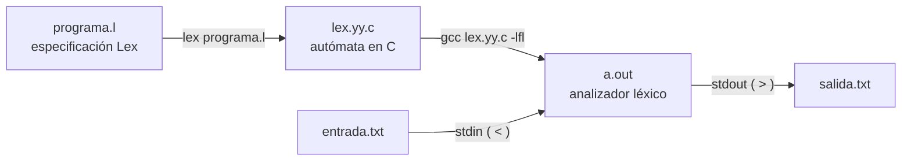

# Laboratorio Lex/Flex – Compiladores y Lenguajes

Escuela Politécnica Nacional · Facultad de Ingeniería de Sistemas
Compiladores y Lenguajes · Periodo 2026-B · Grupo GR2CD

| Integrantes | Ejercicios a cargo |
|---|---|
| James Caiño | 1 al 5 |
| Jhon Tiupul | _pendiente_ |
| Alejandro Guanocunga | _pendiente_ |

Docente: Rodrigo Fabián Changusic Chuquilla

---

## Descripción

Este repositorio reúne los 13 ejercicios del laboratorio de analizadores léxicos con Lex/Flex. Cada ejercicio tiene su propia carpeta, con la especificación Lex, el código C generado, el ejecutable, los archivos de prueba y un informe en PDF que explica el código, las pruebas realizadas y el comportamiento observado.

El objetivo de la práctica es llevar a la práctica lo visto en clase sobre expresiones regulares y autómatas finitos. Lex recibe un conjunto de patrones (expresiones regulares) con acciones en C y genera automáticamente el autómata que reconoce esos patrones en un flujo de caracteres. Los ejercicios van desde el programa Lex más simple posible hasta reconocedores de números reales y clasificadores de caracteres.

## Entorno de trabajo

| Componente | Versión / detalle |
|---|---|
| Sistema operativo | Ubuntu MATE en VirtualBox |
| Generador léxico | Flex (comando `lex`) |
| Compilador | GCC |
| Biblioteca | `libfl` (aporta `main()` y `yywrap()` por defecto) |

Instalación de las herramientas:

```bash
sudo apt update
sudo apt install flex gcc build-essential
```

## Flujo de compilación y ejecución

Todos los ejercicios siguen el mismo ciclo:



```bash
lex programa.l                       # genera lex.yy.c
gcc lex.yy.c -lfl                    # genera el ejecutable a.out
./a.out                              # ejecución interactiva (terminar con Ctrl+D)
./a.out < entrada.txt > salida.txt   # ejecución con redirección de archivos
```

## Estructura de un programa Lex

```
{ definiciones }      código C entre %{ %} y definiciones regulares
%%
{ reglas }            patrón   acción-en-C
%%
{ subrutinas }        main() y funciones auxiliares
```

Para entender los resultados de los ejercicios hay que tener presentes tres comportamientos de Lex:

1. **Coincidencia más larga:** si varios patrones pueden aplicarse, Lex elige el que reconoce más caracteres.
2. **Prioridad por orden:** si dos patrones reconocen la misma cantidad de caracteres, gana el que está escrito primero.
3. **Acción por defecto (ECHO):** todo carácter que no coincide con ningún patrón se copia sin cambios a la salida.

## Estructura del repositorio

```
.
├── README.md
├── Ejercicio01/   uno.l       · Programa básico Lex
├── Ejercicio02/   dos.l       · Ejecución de órdenes
├── Ejercicio03/   tres.l      · Contador de líneas y caracteres
├── Ejercicio04/   cuatro.l    · Números, identificadores y reales exponenciales
├── Ejercicio05/   contador.l  · Clasificación de caracteres
├── Ejercicio06/ … Ejercicio13/
```

Cada carpeta contiene:

| Archivo | Contenido |
|---|---|
| `*.l` | especificación Lex del ejercicio |
| `lex.yy.c` | analizador en C generado por Lex |
| `a.out` | ejecutable compilado |
| `entrada.txt` | texto de prueba |
| `salida.txt` | resultado de `./a.out < entrada.txt > salida.txt` |
| `Informe_EjercicioXX.pdf` | informe con el código explicado, las capturas y el análisis |

## Índice de ejercicios

| N.º | Carpeta | Archivo | Tema | Fuente | Responsable |
|---|---|---|---|---|---|
| 1 | [Ejercicio01](Ejercicio01) | `uno.l` | Programa Lex mínimo | Semana 4, diap. 41 | James Caiño |
| 2 | [Ejercicio02](Ejercicio02) | `dos.l` | Ejecución de órdenes (`pare`, `inicio`) | Semana 4, diap. 42–43 | James Caiño |
| 3 | [Ejercicio03](Ejercicio03) | `tres.l` | Contador de líneas y caracteres | Semana 4, diap. 44–47 | James Caiño |
| 4 | [Ejercicio04](Ejercicio04) | `cuatro.l` | Números, identificadores y reales en notación exponencial | Semana 4, diap. 48–49 | James Caiño |
| 5 | [Ejercicio05](Ejercicio05) | `contador.l` | Clasificación de caracteres | Semana 6, ejercicio 1 | James Caiño |
| 6 | Ejercicio06 | _pendiente_ | _pendiente_ | | |
| 7 | Ejercicio07 | _pendiente_ | _pendiente_ | | |
| 8 | Ejercicio08 | _pendiente_ | _pendiente_ | | |
| 9 | Ejercicio09 | _pendiente_ | _pendiente_ | | |
| 10 | Ejercicio10 | _pendiente_ | _pendiente_ | | |
| 11 | Ejercicio11 | _pendiente_ | _pendiente_ | | |
| 12 | Ejercicio12 | _pendiente_ | _pendiente_ | | |
| 13 | Ejercicio13 | _pendiente_ | _pendiente_ | | |

---

## Resumen técnico de los ejercicios 1 al 5

### Ejercicio 1 – Programa básico Lex (`uno.l`)

```lex
%%
```

Es la especificación más pequeña que Lex acepta: las tres secciones están vacías. Aun así, Lex generó un `lex.yy.c` de 1725 líneas (43 756 bytes), con la función `yylex()` y las tablas del autómata.

- Sin reglas, todo carácter cae en la acción ECHO, así que la salida es idéntica a la entrada. Lo comprobamos con `diff entrada.txt salida.txt`, que no mostró diferencias.
- Al compilar sin `-lfl`, el enlazador reporta `undefined reference to 'main'` y `'yywrap'`, porque el archivo no define ninguna de las dos funciones.
- El analizador no rechaza ninguna cadena: no hay patrones contra los cuales validar la entrada.

### Ejercicio 2 – Ejecución de órdenes (`dos.l`)

```lex
pare     printf("Comando pare recibido\n");
inicio   printf("Comando inicio ejecutado\n");
```

Es el primer uso de la sección de reglas: cada patrón literal dispara una acción en C.

| Entrada | Salida | Explicación |
|---|---|---|
| `pare` | Comando pare recibido | coincide con la regla 1 |
| `PARE` | PARE | los patrones distinguen mayúsculas |
| `parece` | Comando pare recibido + `ce` | Lex reconoce secuencias, no palabras completas |
| `iniciopare` | ambos mensajes | reconoce `inicio` y luego `pare` |

Las líneas en blanco de la salida se deben al `\n` del `printf` más el salto de línea de la entrada, que se copia por ECHO.

### Ejercicio 3 – Contador de líneas y caracteres (`tres.l`)

```lex
[\n]    numlin++;
.       numcar++;
```

Usa las tres secciones: los contadores se declaran como variables globales, las reglas los incrementan y `main()` imprime los totales después de `yylex()`. Como el patrón `.` no acepta el salto de línea, las dos reglas cubren toda la entrada sin contar ningún carácter dos veces.

| Entrada | Líneas | Caracteres | Observación |
|---|---|---|---|
| `entrada.txt` (3 líneas) | 3 | 42 | `wc -c` reporta 45 = 42 + 3 saltos |
| `abc` sin salto final | 0 | 3 | las líneas se cuentan por `\n` |
| tres saltos de línea | 3 | 0 | `.` no acepta `\n` |
| `canción` | 1 | 8 | la «ó» ocupa 2 bytes en UTF-8 |

### Ejercicio 4 – Números, identificadores y reales exponenciales (`cuatro.l`)

Versión final, con la expresión regular de reales dada en clase traducida a Flex:

```lex
DIGITO      [0-9]
REAL        [+-]?{DIGITO}+(\.{DIGITO}+)?([Ee][+-]?{DIGITO}+)?
%%
{DIGITO}+               printf("NUMERO \n");
{REAL}                  printf("NUMERO REAL \n");
[a-zA-Z][a-zA-Z0-9]*    printf("IDENTIFICADOR \n");
```

La versión básica, sin la regla `{REAL}`, partía `6.02E23` en cuatro tokens. Con la ampliación se reconoce como un solo NUMERO REAL.

| Entrada | Token | Regla que decide |
|---|---|---|
| `25` | NUMERO | empate de longitud: gana `{DIGITO}+` por ir primero |
| `3.14`, `6.02E23`, `1e-5`, `-2.5e+3` | NUMERO REAL | coincidencia más larga |
| `-7` | NUMERO REAL | la ER de reales admite signo |
| `3.` / `.5` | NUMERO + «.» | la ER exige dígitos a ambos lados del punto |
| `1e` | NUMERO + IDENTIFICADOR | el exponente necesita dígitos |
| `2abc`, `3a14` | NUMERO + IDENTIFICADOR | un identificador no empieza con dígito |

El punto decimal se escapa como `\.`; sin la barra significaría «cualquier carácter» y `3a14` se aceptaría como real.

### Ejercicio 5 – Clasificación de caracteres (`contador.l`)

```lex
[A-Z]   mayus++;
[a-z]   minus++;
[0-9]   digitos++;
" "     espacios++;
\t      tabs++;
\n      saltos++;
.       otros++;
```

Cada regla reconoce un solo carácter y lo asigna a una clase. Esa es la etapa previa a la formación de tokens: los tokens aparecen cuando estas mismas clases se combinan con operadores de repetición (`[a-zA-Z][a-zA-Z0-9]*`, `[0-9]+`). La regla `.` garantiza que todo carácter quede clasificado. Lo verificamos sumando los contadores (57) y comparando con `wc -c` (57 bytes).

| Entrada | Resultado relevante | Explicación |
|---|---|---|
| `HOLA SOMOS EL GRUPO 4 EPN 2026` | 19 mayúsculas, 5 dígitos, 7 blancos | 6 espacios + 1 salto |
| `Año` | 2 en «otros» | la ñ no está en `[a-z]` y ocupa 2 bytes |
| `x=y+1;` | 3 en «otros» | `=`, `+` y `;` serían tokens de operador en un analizador completo |

---

## Conclusiones de la primera parte

- El ciclo `lex` → `gcc -lfl` → `a.out` funciona igual en todos los ejercicios. Lo que cambia entre uno y otro son los patrones y las acciones.
- La coincidencia más larga y la prioridad por orden explican casi todos los resultados «inesperados», como `parece`, `25` frente a `3.14`, o `-7`.
- Lex trabaja byte por byte, así que las letras con tilde y la ñ cuentan como dos caracteres en los ejercicios 3 y 5.
- Ninguno de estos analizadores rechaza cadenas de forma explícita: lo que no coincide con una regla se copia (ECHO) o, en el Ejercicio 5, se cuenta como «otros». Validar la entrada requiere reglas específicas de error.

## Video de exposición

Enlace: _pendiente_

## Referencias

- Escuela Politécnica Nacional. (2026). *Compiladores y Lenguajes: Semana 04 – Generador de analizadores léxicos LEX* y *Semana 06 – Ejercicios Lex/Flex*. Diapositivas de clase, periodo 2026-B.
- Paxson, V., Estes, W. y Millaway, J. *Lexical Analysis With Flex*. https://westes.github.io/flex/manual/
